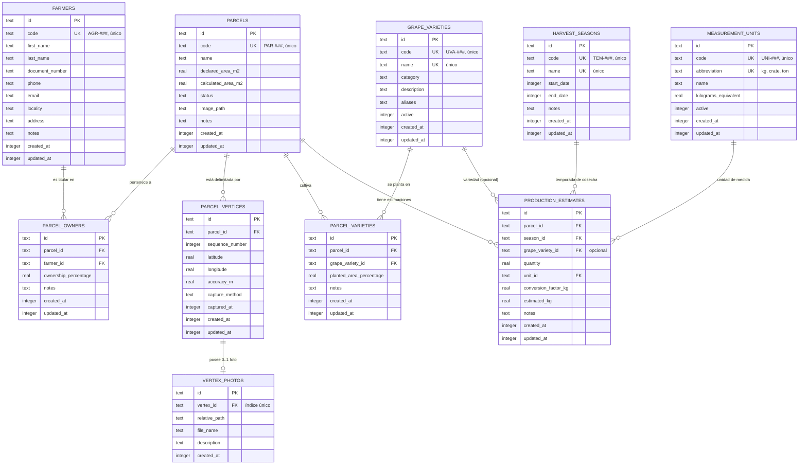

# CatastroDemo

Aplicación móvil desarrollada en Flutter para la gestión catastral vitivinícola, registro de parcelas georreferenciadas, productores vitícolas, variedades de uva cultivadas, estimaciones de rendimiento y exportación offline de datos e imágenes.

Diseñada y optimizada para operar de manera autónoma en campo sobre dispositivos móviles Android (probada y validada en hardware real: **POCO M6 Pro**).

---

## Tabla de Contenidos

1. [Visión General](#visión-general)
2. [Tech Stack](#tech-stack)
3. [Arquitectura y Diseño](#arquitectura-y-diseño)
4. [Estructura del Proyecto](#estructura-del-proyecto)
5. [Modelo de Persistencia y Base de Datos](#modelo-de-persistencia-y-base-de-datos)
6. [Módulos y Funcionalidades](#módulos-y-funcionalidades)
   - [Gestión de Agricultores](#gestión-de-agricultores)
   - [Catastro de Parcelas](#catastro-de-parcelas)
   - [Vértices y Geometría en Tiempo Real](#vértices-y-geometría-en-tiempo-real)
   - [Variedades Vitícolas](#variedades-vitícolas)
   - [Estimaciones de Producción](#estimaciones-de-producción)
   - [Exportación de Respaldos (JSON y ZIP)](#exportación-de-respaldos-json-y-zip)
7. [Instalación y Ejecución](#instalación-y-ejecución)
8. [Calidad del Código y Pruebas](#calidad-del-código-y-pruebas)
9. [Flujo Git (Gitflow)](#flujo-git-gitflow)
10. [Contacto](#contacto)

---

## Visión General

**CatastroDemo** resuelve el problema de registro y validación catastral agrícola en zonas rurales sin conectividad a Internet. Proporciona:
- Códigos correlativos autogenerados y de solo lectura en las cinco entidades (`AGR-001`, `PAR-001`, `UVA-001`, `UNI-001`, `TEM-001`).
- Mapeo de polígonos mediante captura GPS de alta precisión y/o adición manual de coordenadas.
- Cálculo de área geodésica instantáneo por excedente esférico en WGS84.
- Manejo de superficie base en metros cuadrados ($m^2$) con conversión interactiva a hectáreas ($ha$).
- Almacenamiento local de fotografías para parcelas y para cada uno de los vértices geodésicos.
- Exportación íntegra de la base de datos y archivos multimedia en formato ZIP portable.

---

## Tech Stack

- **Lenguaje:** [Dart 3.x](https://dart.dev/)
- **Framework UI:** [Flutter 3.x](https://flutter.dev/) (Material Design 3)
- **Gestor de Estado y DI:** [Riverpod 2.x / 3.x](https://riverpod.dev/) (`flutter_riverpod`)
- **Persistencia Local (ORM):** [Drift](https://drift.simonbinder.eu/) (SQLite relacional con tipos seguros)
- **Base de Datos:** SQLite embebido con claves foráneas activas (`PRAGMA foreign_keys = ON`)
- **Geolocalización:** [geolocator](https://pub.dev/packages/geolocator) (servicios GPS de alta precisión)
- **Mapas y Renderizado Geo:** [flutter_map](https://pub.dev/packages/flutter_map) + [latlong2](https://pub.dev/packages/latlong2)
- **Manejo de Imágenes:** [image_picker](https://pub.dev/packages/image_picker) + almacenamiento privado en sandbox, con recodificación a JPEG al guardar mediante [image](https://pub.dev/packages/image) (calidad 80, lado mayor 1600 px)
- **Compresión y Exportación:** [archive](https://pub.dev/packages/archive) (generación de ZIP y JSON estructurados)
- **Compartición de Archivos:** [share_plus](https://pub.dev/packages/share_plus)
- **Generación de Código:** `build_runner`, `drift_dev`

---

## Arquitectura y Diseño

El proyecto sigue una arquitectura limpia orientada al dominio (**Clean Architecture / Feature-First**):

```
┌────────────────────────────────────────────────────────┐
│             Presentation Layer (UI & Widgets)          │
│         Formularios, Vistas de Lista, Mapas, Diálogos  │
└───────────────────────────▲────────────────────────────┘
                            │ (Escucha Notificadores / Providers)
┌───────────────────────────┴────────────────────────────┐
│              Application / Riverpod Providers          │
│         StreamProviders, FutureProviders, Controllers  │
└───────────────────────────▲────────────────────────────┘
                            │ (Invoca Casos de Uso / Repositorios)
┌───────────────────────────┴────────────────────────────┐
│                    Domain Layer                        │
│         Entidades Inmutables, Contratos, Algoritmos    │
│    (PolygonValidator, ParcelAreaCalculator, Math)      │
└───────────────────────────▲────────────────────────────┘
                            │ (Implementado por)
┌───────────────────────────┴────────────────────────────┐
│              Data / Infrastructure Layer               │
│         Drift DAOs, SQLite, PhotoStorage, GPS Service  │
└────────────────────────────────────────────────────────┘
```

### Principios Fundamentales:
1. **Independencia del Dominio:** Las entidades del dominio no dependen de Drift ni de paquetes de UI.
2. **Medida Base Canónica:** La superficie se persiste siempre en metros cuadrados ($m^2$). La conversión a hectáreas ($ha$) es una vista derivada ($1\text{ ha} = 10\,000\text{ m}^2$).
3. **Persistencia Transaccional:** Todas las operaciones complejas (como reemplazar los vértices de un polígono o vincular propietarios) se realizan en transacciones atómicas de SQLite.
4. **Reactividad con Streams:** Los repositorios exponen `watch*` para que la interfaz se actualice de forma reactiva al modificar coordenadas o datos.

---

## Estructura del Proyecto

```text
lib/
├── core/                                # Componentes transversales
│   ├── database/                        # Configuración SQLite / Drift
│   │   ├── daos/                        # Data Access Objects (ParcelDao, FarmerDao, etc.)
│   │   ├── app_database.dart            # Definición de la base de datos y migraciones
│   │   └── tables.dart                  # Esquema de tablas Drift
│   ├── di/                              # Inyección de dependencias global
│   ├── errors/                          # Clases de fallo (AppFailure, ValidationFailure)
│   ├── formatting/                      # Formateadores numéricos y de texto (Formatters)
│   ├── geo/                             # Coordenadas (GeoPoint)
│   ├── location/                        # Servicio de geolocalización GPS
│   ├── media/                           # Servicio de selección de fotos
│   ├── storage/                         # Almacenamiento privado de imágenes (PhotoStorage)
│   ├── validation/                      # Validadores compartidos (Validators)
│   └── widgets/                         # Componentes UI reutilizables (SectionCard, AsyncView, PhotoViewer, PhotoButton)
├── features/                            # Módulos funcionales de la aplicación
│   ├── data_export/                     # Exportación a JSON y ZIP con fotos
│   ├── farmers/                         # Gestión de productores vitícolas
│   ├── grape_varieties/                 # Catálogo de variedades de uva (Blanca / Tinta)
│   ├── parcel_owners/                   # Vinculación agricultor - parcela y porcentajes
│   ├── parcels/                         # Parcela, vértices, mapa y cálculo de superficie
│   ├── production/                      # Estimaciones de cosecha y unidades de medida
│   └── vertex_photos/                   # Fotografías asociadas a vértices geodésicos
└── main.dart                            # Punto de entrada de la aplicación
```

---

## Modelo de Persistencia y Base de Datos

La base de datos SQLite se gestiona mediante Drift. El esquema se declara en `lib/core/database/tables.dart`, la configuración y las migraciones en `app_database.dart`, y el acceso a datos en los DAO de `lib/core/database/daos/`.

Convenciones del esquema:
- La clave primaria `id` es un **UUID v4 en `TEXT`**, generado por la aplicación; nunca un entero autoincremental.
- Los nombres de columna siguen `snake_case`; las fechas se guardan en **UTC**.
- Las restricciones (`UNIQUE`, `CHECK`, `FOREIGN KEY`) se declaran en SQLite además de validarse en dominio.
- Las claves foráneas se activan en cada apertura (`PRAGMA foreign_keys = ON`), por lo que los borrados en cascada y las restricciones se aplican de verdad.

### 5.1 Diagrama entidad-relación



### 5.2 Detalle de campos por tabla

#### `farmers` — Agricultores
| Campo | Tipo | Restricciones |
| --- | --- | --- |
| `id` | TEXT | PK, UUID v4 |
| `code` | TEXT | Único (`AGR-###`); anulable solo por la migración v3 |
| `first_name` | TEXT | Obligatorio, 1–120 |
| `last_name` | TEXT | Obligatorio, 1–120 |
| `document_number` | TEXT | Opcional |
| `phone` | TEXT | Opcional |
| `email` | TEXT | Opcional |
| `locality` | TEXT | Opcional |
| `address` | TEXT | Opcional |
| `notes` | TEXT | Opcional |
| `created_at` / `updated_at` | INTEGER | Obligatorios, UTC |

#### `parcels` — Parcelas
| Campo | Tipo | Restricciones |
| --- | --- | --- |
| `id` | TEXT | PK, UUID v4 |
| `code` | TEXT | Único (`PAR-###`), 1–40 |
| `name` | TEXT | Opcional |
| `declared_area_m2` | REAL | Opcional, `CHECK >= 0` |
| `calculated_area_m2` | REAL | Opcional, `CHECK >= 0` (superficie geodésica) |
| `status` | TEXT | Obligatorio (enum `ParcelStatus`) |
| `image_path` | TEXT | Opcional, ruta relativa `photos/<archivo>` |
| `notes` | TEXT | Opcional |
| `created_at` / `updated_at` | INTEGER | Obligatorios, UTC |

#### `parcel_owners` — Titularidad agricultor ↔ parcela
| Campo | Tipo | Restricciones |
| --- | --- | --- |
| `id` | TEXT | PK, UUID v4 |
| `parcel_id` | TEXT | FK → `parcels.id`, `ON DELETE CASCADE` |
| `farmer_id` | TEXT | FK → `farmers.id`, `ON DELETE RESTRICT` |
| `ownership_percentage` | REAL | Opcional, `CHECK` 0–100 |
| `notes` | TEXT | Opcional |
| `created_at` / `updated_at` | INTEGER | Obligatorios, UTC |
| — | — | `UNIQUE (parcel_id, farmer_id)` |

#### `parcel_vertices` — Vértices geodésicos
| Campo | Tipo | Restricciones |
| --- | --- | --- |
| `id` | TEXT | PK, UUID v4 |
| `parcel_id` | TEXT | FK → `parcels.id`, `ON DELETE CASCADE` |
| `sequence_number` | INTEGER | Obligatorio, `CHECK >= 0` |
| `latitude` | REAL | Obligatorio, `CHECK` −90–90 |
| `longitude` | REAL | Obligatorio, `CHECK` −180–180 |
| `accuracy_m` | REAL | Opcional (precisión GPS), `CHECK >= 0` |
| `capture_method` | TEXT | Obligatorio (enum `VertexCaptureMethod`: GPS / manual) |
| `captured_at` | INTEGER | Opcional, UTC |
| `created_at` / `updated_at` | INTEGER | Obligatorios, UTC |
| — | — | `UNIQUE (parcel_id, sequence_number)` |

#### `vertex_photos` — Fotografías de vértice (0..1 por vértice)
| Campo | Tipo | Restricciones |
| --- | --- | --- |
| `id` | TEXT | PK, UUID v4 |
| `vertex_id` | TEXT | FK → `parcel_vertices.id`, `ON DELETE CASCADE` |
| `relative_path` | TEXT | Obligatorio, `photos/<archivo>` |
| `file_name` | TEXT | Obligatorio, `photo_<uuid>.<ext>` |
| `description` | TEXT | Opcional |
| `created_at` | INTEGER | Obligatorio, UTC |
| — | — | `UNIQUE INDEX idx_vertex_photos_vertex (vertex_id)` → máximo 1 fila por vértice (RN-31) |

#### `grape_varieties` — Variedades vitícolas
| Campo | Tipo | Restricciones |
| --- | --- | --- |
| `id` | TEXT | PK, UUID v4 |
| `code` | TEXT | Único (`UVA-###`); anulable solo por migración |
| `name` | TEXT | Obligatorio, 1–80, único |
| `category` | TEXT | Opcional (`Blanca` / `Tinta`) |
| `description` | TEXT | Opcional |
| `aliases` | TEXT | Opcional |
| `active` | INTEGER | Obligatorio, por defecto 1 |
| `created_at` / `updated_at` | INTEGER | Obligatorios, UTC |

#### `parcel_varieties` — Variedad ↔ parcela y % de terreno
| Campo | Tipo | Restricciones |
| --- | --- | --- |
| `id` | TEXT | PK, UUID v4 |
| `parcel_id` | TEXT | FK → `parcels.id`, `ON DELETE CASCADE` |
| `grape_variety_id` | TEXT | FK → `grape_varieties.id`, `ON DELETE RESTRICT` |
| `planted_area_percentage` | REAL | Opcional, `CHECK` 0–100 |
| `notes` | TEXT | Opcional |
| `created_at` / `updated_at` | INTEGER | Obligatorios, UTC |
| — | — | `UNIQUE (parcel_id, grape_variety_id)` |

#### `harvest_seasons` — Temporadas de vendimia
| Campo | Tipo | Restricciones |
| --- | --- | --- |
| `id` | TEXT | PK, UUID v4 |
| `code` | TEXT | Único (`TEM-###`) |
| `name` | TEXT | Obligatorio, 1–60, único |
| `start_date` | INTEGER | Opcional, UTC |
| `end_date` | INTEGER | Opcional, UTC |
| `notes` | TEXT | Opcional |
| `created_at` / `updated_at` | INTEGER | Obligatorios, UTC |
| — | — | `CHECK (start_date <= end_date)` cuando ambas existen |

#### `measurement_units` — Unidades de medida
| Campo | Tipo | Restricciones |
| --- | --- | --- |
| `id` | TEXT | PK, UUID v4 |
| `code` | TEXT | Único (`UNI-###`), 1–16 |
| `abbreviation` | TEXT | Único (`kg`, `crate`, `ton`); es la etiqueta visible |
| `name` | TEXT | Obligatorio, 1–60 |
| `kilograms_equivalent` | REAL | Opcional, `CHECK > 0` (nulo = factor definido por estimación) |
| `active` | INTEGER | Obligatorio, por defecto 1 |
| `created_at` / `updated_at` | INTEGER | Obligatorios, UTC |

#### `production_estimates` — Estimaciones de producción
| Campo | Tipo | Restricciones |
| --- | --- | --- |
| `id` | TEXT | PK, UUID v4 |
| `parcel_id` | TEXT | FK → `parcels.id`, `ON DELETE CASCADE` |
| `season_id` | TEXT | FK → `harvest_seasons.id`, `ON DELETE RESTRICT` |
| `grape_variety_id` | TEXT | FK → `grape_varieties.id`, `ON DELETE RESTRICT`; **nulo = estimación general** |
| `quantity` | REAL | Obligatorio, `CHECK > 0` |
| `unit_id` | TEXT | FK → `measurement_units.id`, `ON DELETE RESTRICT` |
| `conversion_factor_kg` | REAL | Obligatorio, `CHECK > 0`; factor aplicado al registrar |
| `estimated_kg` | REAL | Obligatorio, `CHECK >= 0`; `quantity × conversion_factor_kg` |
| `notes` | TEXT | Opcional |
| `created_at` / `updated_at` | INTEGER | Obligatorios, UTC |
| — | — | **Sin `UNIQUE`**: una parcela admite varias estimaciones por temporada |

### 5.3 Cómo se guardan las estimaciones de producción

Cada fila de `production_estimates` es **una** estimación de cosecha y guarda, a la vez, la cantidad original y su equivalencia en kilogramos:

- `quantity` + `unit_id`: la cantidad tal como la cargó el usuario y la unidad elegida (por ejemplo, `12.5` en la unidad `crate`).
- `conversion_factor_kg`: el factor aplicado **en el momento del registro**. Se copia dentro de la fila, no se referencia; por eso cambiar después la equivalencia de una unidad no altera las estimaciones existentes (RN-25).
- `estimated_kg`: el resultado persistido de `quantity × conversion_factor_kg` (RN-24). Se calcula en el repositorio con `ProductionMath.estimatedKg` antes de escribir y se guarda completo; el redondeo a 2 decimales es solo de presentación y no toca el valor almacenado.
- `season_id`: la temporada de vendimia (`harvest_seasons`), obligatoria. `parcel_id`: la parcela, obligatoria.
- `grape_variety_id`: **nulo** significa estimación **general de la parcela**; con valor, es la estimación de esa variedad concreta. Un resumen elige un modo u otro, nunca suma ambos (RN-26).
- No hay restricción `UNIQUE` sobre `(parcel_id, season_id, grape_variety_id)`: se pueden registrar varias estimaciones para la misma parcela y temporada (una general y/o una por cada variedad).

Ejemplo de fila almacenada:

```json
{
  "id": "b1f0…",
  "parcel_id": "c2a7…",
  "season_id": "9d13…",
  "grape_variety_id": null,
  "quantity": 12.5,
  "unit_id": "4e88…",
  "conversion_factor_kg": 18.0,
  "estimated_kg": 225.0,
  "notes": "Muestra de la primera pasada",
  "created_at": "2026-03-02T14:05:00Z",
  "updated_at": "2026-03-02T14:05:00Z"
}
```

Restricciones de integridad asociadas:
- Borrar una **parcela** elimina en cascada sus estimaciones (`ON DELETE CASCADE`).
- Borrar una **temporada** o una **unidad** usada por estimaciones se rechaza (`ON DELETE RESTRICT`); el dominio lo traduce a `InUseFailure` y ofrece desactivarla en su lugar.
- La variedad de la estimación debe existir en `grape_varieties` (o ser nula).

### 5.4 Relaciones y cardinalidades
- Agricultor **N:M** parcela, resuelta por `parcel_owners` (con porcentaje de titularidad).
- Parcela **1:N** vértices ordenados por `sequence_number`.
- Vértice **1:0..1** fotografía (`vertex_photos`, RN-31).
- Parcela **N:M** variedad, resuelta por `parcel_varieties` (con porcentaje de terreno).
- Parcela **1:N** estimaciones; temporada **1:N** estimaciones; unidad **1:N** estimaciones; variedad **0..1:N** estimaciones.

### 5.5 Índices
Además de las claves únicas declaradas en cada tabla, el esquema crea índices para las consultas frecuentes: `idx_farmers_name`, `idx_farmers_document`, `idx_farmers_code`, `idx_parcels_status`, `idx_parcel_owners_farmer`, `idx_grape_varieties_active`, `idx_parcel_varieties_variety`, `idx_production_parcel_season`, `idx_production_season`, `idx_production_variety`, `idx_production_unit` y el índice **único** `idx_vertex_photos_vertex`.

### 5.6 Catálogos sembrados
Al crear la base desde cero (`onCreate`) se siembran catálogos editables:
- Variedades: Moscatel de Alejandría (Blanca), Malbec (Tinta), Cabernet Sauvignon (Tinta), Syrah (Tinta).
- Unidades: Kilogramo (`kg`, equivalencia 1.0), Cajón (`crate`, sin equivalencia universal), Tonelada (`ton`, equivalencia 1000.0).

La equivalencia del cajón se define por estimación, no en el catálogo.

### 5.7 Migraciones de esquema (`currentSchemaVersion = 4`)
- **Versión 1:** Tablas fundacionales de agricultores, parcelas, geometría, variedades y estimaciones.
- **Versión 2:** Columna `image_path TEXT NULL` en `parcels` (`migrator.addColumn(parcels, parcels.imagePath)`).
- **Versión 3:** Códigos de registro autogenerados en `farmers.code`, `grape_varieties.code` y `harvest_seasons.code`, y abreviatura propia en `measurement_units.abbreviation`. La migración agrega las columnas, rellena los datos existentes (mueve el `AGR-###` que vivía en `document_number`, copia `kg`/`crate`/`ton` a la abreviatura y regenera `code` como `UNI-###`) y crea los índices únicos explícitos, porque `uniqueKeys` solo se aplica en la creación inicial y una base migrada quedaría sin ellos.
- **Versión 4:** Un vértice pasa a tener a lo sumo una fotografía (RN-31). La migración depura primero los duplicados históricos conservando la foto más antigua de cada vértice (mismo criterio que `findByVertex`), elimina el índice no único anterior y crea `idx_vertex_photos_vertex` como **único** sobre `vertex_photos(vertex_id)`. Los archivos de las filas eliminadas quedan huérfanos y se recuperan desde la depuración de mantenimiento (RN-30 y RN-35).

---

## Módulos y Funcionalidades

### 1. Gestión de Agricultores
- **Código de Registro de Solo Lectura:** Correlativo autogenerado con formato `AGR-001`, `AGR-002`. Se muestra como campo `Código` (etiqueta corta `COD`) que el usuario no puede modificar; el sistema lo asigna y evita conflictos.
- **Documento/CI Opcional:** Campo `Documento` independiente del código y opcional, junto al resto de los datos.
- **Validación de Nombre y Apellido:** solo letras (incluye acentos y `Ñ`) y espacios internos; se eliminan los espacios al inicio y al fin y se colapsan los repetidos.
- Registro de nombres, apellidos, teléfono, correo electrónico, localidad y domicilio.
- Regla de integridad: no se permite eliminar un agricultor si tiene parcelas vinculadas activas.

### 2. Catastro de Parcelas
- **Código de Registro de Solo Lectura:** Correlativo autogenerado con formato `PAR-001`, `PAR-002`; el usuario lo ve pero no lo edita.
- **Asociación Restringida a Agricultores:** No se permiten campos abiertos; se selecciona obligatoriamente de la lista existente de agricultores registrados.
- **Fotografía de la Parcela:** Captura desde cámara o galería, almacenada de forma segura en la sandbox privada de la app. Antes de escribirse, la imagen se recodifica como JPEG (calidad 80, lado mayor 1600 px); si el archivo no se puede decodificar o el resultado no reduce el peso, se conserva el original sin pérdida.
- **Visor de Fotografía:** La foto se muestra como botón; al tocar abre un visor a pantalla completa con zoom. Desde el visor del detalle se puede eliminar la foto (registro y archivo), y «Quitar foto» en el formulario también elimina el archivo del almacenamiento privado.
- **Unidad de Superficie Declarada:** Entrada en $m^2$ o $ha$ mediante un toggle interactivo (`SegmentedButton`) que recalcula y muestra la equivalencia en vivo.

### 3. Vértices y Geometría en Tiempo Real
- **Captura GPS:** Integra el sensor del dispositivo mediante `LocationService` obteniendo coordenadas y radio de precisión ($\pm\text{m}$).
- **Ingreso Manual de Coordenadas:** Diálogo modular (`ManualVertexDialog`) para introducir pares de latitud y longitud.
- **Edición de Coordenadas Manuales:** El menú de cada vértice manual ofrece «Editar coordenadas» y reabre el diálogo precargado con la posición actual; los vértices capturados con GPS conservan su posición medida y no se editan.
- **Recálculo de Superficie en Vivo:** Banner dinámico (`_VertexAreaBanner`) que evalúa el polígono al instante:
  - Valida que tenga al menos 3 vértices.
  - Verifica que no existan auto-intersecciones de aristas (`PolygonValidator`).
  - Calcula la superficie en $m^2$ y $ha$ usando la fórmula del excedente esférico (`ParcelAreaCalculator`).
- **Previsualización de Imágenes en Vértices:** Miniaturas gráficas ($44\times 44\text{ px}$) en la lista de vértices para aquellos puntos que cuenten con fotografías tomadas en campo. En el diálogo del vértice, cada miniatura abre el visor a pantalla completa y desde allí puede eliminarse la foto.

### 4. Variedades Vitícolas
- Catálogo editable de variedades de vid.
- **Código de Registro de Solo Lectura:** Correlativo autogenerado con formato `UVA-001`, `UVA-002`.
- **Categorías Restringidas:** Filtradas estrictamente a dos opciones universales: **Blanca** y **Tinta**.
- Soporte para asociar múltiples variedades a una parcela indicando el porcentaje de distribución del terreno.

### 5. Estimaciones de Producción
- Registro de estimaciones por temporada de vendimia (`HarvestSeason`) y unidad de medida (`MeasurementUnit`). La temporada usa un código `TEM-###` y la unidad un código `UNI-###`, ambos de solo lectura.
- **Abreviatura de Unidad Editable:** La unidad conserva su abreviatura (`kg`, `cajón`, `ton`) en un campo propio, obligatorio y único, que es el que se muestra junto a las cantidades y el que el usuario necesita para crear sus propias unidades y convertir a kilogramos.
- **Factor de Conversión Flexible:** Admite unidades estándar (kg, Tonelada con factor 1000) o configurables (cajón) parseando números con decimales y separadores regionales (`1000,00` o `1000`).
- **Persistencia:** cada estimación guarda la cantidad original, la unidad usada, el factor de conversión aplicado y su equivalencia en kilogramos. El detalle de campos y relaciones está en [Cómo se guardan las estimaciones de producción](#53-cómo-se-guardan-las-estimaciones-de-producción).

### 6. Exportación de Respaldos (JSON y ZIP)
- **JSON Estructurado:** Vaciado íntegro de todas las tablas con marcas de tiempo en formato ISO-8601. El formato va marcado con `schemaVersion` (v2 desde la inclusión del código de registro y la abreviatura de unidad; es la versión del **respaldo**, independiente del esquema de la base de datos, que va por la 4).
- **Respaldo ZIP Completo:** Empaqueta:
  - `data.json`: Todas las entidades catastrales.
  - `manifest.json`: Información de versión y estructura.
  - `photos/`: **Todas las fotografías de las parcelas** y **todas las fotografías de los vértices geodésicos**.

---

## Instalación y Ejecución

### Requisitos Previos:
- Flutter SDK 3.x instalado.
- Android SDK configurado (API 24 mínimo, API 34+ recomendado).
- Dispositivo Android con depuración USB habilitada.

### Pasos:

1. **Clonar el repositorio:**
   ```bash
   git clone https://github.com/ItsMeEli173/CatastroDemo.git
   cd CatastroDemo
   ```

2. **Obtener dependencias:**
   ```bash
   flutter pub get
   ```

3. **Generar código de Drift (si se modifica el esquema):**
   ```bash
   flutter pub run build_runner build --delete-conflicting-outputs
   ```

4. **Ejecutar en el dispositivo:**
   ```bash
   flutter run -d <DEVICE_ID>
   ```

5. **Compilar APK de entrega:**
   ```bash
   flutter build apk --release
   ```
   *El instalable se generará en `build/app/outputs/flutter-apk/app-release.apk`.*

### Permisos de Android

La aplicación declara los siguientes permisos en `android/app/src/main/AndroidManifest.xml`:

- `ACCESS_FINE_LOCATION` y `ACCESS_COARSE_LOCATION`: captura GPS de los vértices.
- `CAMERA`: fotografías de parcelas y de vértices.
- `READ_MEDIA_IMAGES` (Android 13+): selección de fotografías desde la galería.
- `READ_EXTERNAL_STORAGE` (Android 12 y anteriores, `maxSdkVersion="32"`): lectura de imágenes en versiones previas.

---

## Calidad del Código y Pruebas

El proyecto cuenta con verificación continua de sintaxis y suite de pruebas automatizadas:

- **Análisis Estático:**
  ```bash
  flutter analyze
  ```
  *(0 issues / No issues found).*

- **Suite de Pruebas Unitarias y de Integración:**
  ```bash
  flutter test
  ```
  Pruebas incluidas en `test/unit/`:
  - `parcel_registration_flow_test.dart`: Flujo completo de código correlativo, creación de agricultor, parcela con imagen, vínculo de titularidad y verificación del siguiente correlativo.
  - `person_name_validation_test.dart`: Normalización y validación de nombres y apellidos (acentos, `Ñ`, espacios internos y de extremos).
  - `registration_code_test.dart`: Formato, parseo y generación del siguiente código; autoridad del repositorio sobre los códigos en las cinco entidades.
  - `schema_migration_test.dart`: Migración real v2 → v4 y v3 → v4 (columnas, relleno de datos, índices únicos, deduplicación de fotos de vértice y rechazo de duplicados).
  - `measurement_unit_test.dart`: Abreviatura visible de la unidad con caída al código cuando falta.
  - `export_payload_test.dart`: El respaldo JSON incluye el código de registro y la abreviatura.
  - `photo_compressor_test.dart`: Reducción del lado mayor, salida JPEG, respeto del tamaño en imágenes chicas y `null` ante bytes que no son una imagen.
  - `photo_storage_test.dart`: La foto se guarda comprimida, y se conserva el original cuando el archivo no es una imagen o cuando comprimir no reduce el peso.
  - `vertex_photo_clean_orphans_test.dart`: La depuración de huérfanos conserva las fotos de parcela y de vértice, y elimina solo el archivo sin registro.
  - `vertex_photo_one_per_vertex_test.dart`: El esquema rechaza una segunda foto por vértice y agregar una nueva reemplaza a la anterior.
  - `vertex_photo_dedupe_invariants_test.dart`: Invariantes de la deduplicación de la migración v4 (queda una sola fila por vértice).
  - `parcel_services_test.dart`: Algoritmos de cálculo de área esférica y validación geométrica de polígonos.
  - `production_math_test.dart`: Cálculos de rendimiento y factores de conversión de cosecha.
  - `widget_test.dart`: Verificación de renderizado inicial de la interfaz.

  Pruebas de widget en `test/widget/`:
  - `farmer_form_test.dart`: El campo `Código` es de solo lectura y el campo `Documento` sigue editable.
  - `photo_viewer_test.dart`: Visor a pantalla completa con y sin borrado; confirmación antes de eliminar.
  - `manual_vertex_dialog_test.dart`: Alta y edición de coordenadas en el diálogo del vértice manual, con validación de rango.
  - `parcel_detail_photo_test.dart`: La foto del detalle abre el visor y su borrado limpia `imagePath` y elimina el archivo.
  - `parcel_form_photo_test.dart`: La foto del formulario abre el visor de solo lectura; «Quitar foto» elimina el archivo.
  - `parcel_vertices_page_test.dart`: «Editar coordenadas» solo aparece en vértices manuales y actualiza el punto mostrado.
  - `vertex_photo_dialog_test.dart`: La miniatura abre el visor y el borrado desde allí recarga la lista.

  Sondas de verificación independiente en `test/probe/`:
  - `image_compression_probe_test.dart`: Sondas derivadas de las specs de compresión de imágenes por un verificador independiente: límites de escala, invariantes de no pérdida y preservación del comportamiento previo.

---

## Flujo Git (Gitflow)

El repositorio sigue una adaptación estricta de **Gitflow**:

- `main`: Código probado y estable en producción.
- `sqa`: Rama de aseguramiento de la calidad y pruebas de integración.
- `dev`: Rama de integración de desarrollo.
- `feature/*` / `bugfix/*`: Ramas temporales de trabajo creadas a partir de `dev` y eliminadas tras su integración.

---

## Contacto

Para consultas técnicas, soporte o información sobre el proyecto:

- **Correo Electrónico:** [elias.aparicio.romero@gmail.com](mailto:elias.aparicio.romero@gmail.com)
- **Repositorio:** [github.com/ItsMeEli173/CatastroDemo](https://github.com/ItsMeEli173/CatastroDemo)
