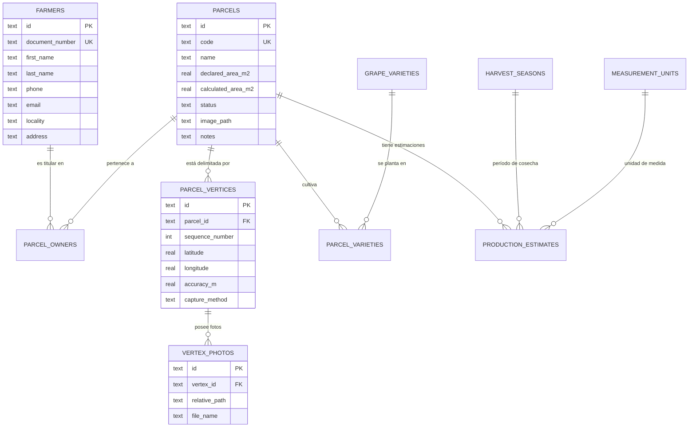

# CatastroDemo

Aplicación móvil desarrollada en Flutter para la gestión catastral vitivinícola, registro de parcelas georreferenciadas, productores vitícolas, variedades de uva cultivadas, estimaciones de rendimiento y exportación offline de datos e imágenes.

Diseñada y optimizada para operar de manera autónoma en campo sobre dispositivos móviles Android (probada y validada en hardware real: **POCO M6 Pro**).

---

## Tabla de Contenidos

1. [Visión General](#visión-general)
2. [Tech Stack](#tech-stack)
3. [Arquitectura y Diseño](#arquitectura-y-diseño)
4. [Estructura del Proyecto](#estructura-del-proyecto)
5. [Modelo de Persistencia y Base de Datos](#modelo-de-persistencia-y-base-de-datos)
6. [Módulos y Funcionalidades](#módulos-y-funcionalidades)
   - [Gestión de Agricultores](#gestión-de-agricultores)
   - [Catastro de Parcelas](#catastro-de-parcelas)
   - [Vértices y Geometría en Tiempo Real](#vértices-y-geometría-en-tiempo-real)
   - [Variedades Vitícolas](#variedades-vitícolas)
   - [Estimaciones de Producción](#estimaciones-de-producción)
   - [Exportación de Respaldos (JSON y ZIP)](#exportación-de-respaldos-json-y-zip)
7. [Instalación y Ejecución](#instalación-y-ejecución)
8. [Calidad del Código y Pruebas](#calidad-del-código-y-pruebas)
9. [Flujo Git (Gitflow)](#flujo-git-gitflow)
10. [Contacto](#contacto)

---

## Visión General

**CatastroDemo** resuelve el problema de registro y validación catastral agrícola en zonas rurales sin conectividad a Internet. Proporciona:
- Códigos correlativos autogenerados (`AGR-001`, `PAR-001`).
- Mapeo de polígonos mediante captura GPS de alta precisión y/o adición manual de coordenadas.
- Cálculo de área geodésica instantáneo por excedente esférico en WGS84.
- Manejo de superficie base en metros cuadrados ($m^2$) con conversión interactiva a hectáreas ($ha$).
- Almacenamiento local de fotografías para parcelas y para cada uno de los vértices geodésicos.
- Exportación íntegra de la base de datos y archivos multimedia en formato ZIP portable.

---

## Tech Stack

- **Lenguaje:** [Dart 3.x](https://dart.dev/)
- **Framework UI:** [Flutter 3.x](https://flutter.dev/) (Material Design 3)
- **Gestor de Estado y DI:** [Riverpod 2.x / 3.x](https://riverpod.dev/) (`flutter_riverpod`)
- **Persistencia Local (ORM):** [Drift](https://drift.simonbinder.eu/) (SQLite relacional con tipos seguros)
- **Base de Datos:** SQLite embebido con claves foráneas activas (`PRAGMA foreign_keys = ON`)
- **Geolocalización:** [geolocator](https://pub.dev/packages/geolocator) (servicios GPS de alta precisión)
- **Mapas y Renderizado Geo:** [flutter_map](https://pub.dev/packages/flutter_map) + [latlong2](https://pub.dev/packages/latlong2)
- **Manejo de Imágenes:** [image_picker](https://pub.dev/packages/image_picker) + almacenamiento privado en sandbox
- **Compresión y Exportación:** [archive](https://pub.dev/packages/archive) (generación de ZIP y JSON estructurados)
- **Compartición de Archivos:** [share_plus](https://pub.dev/packages/share_plus)
- **Generación de Código:** `build_runner`, `drift_dev`

---

## Arquitectura y Diseño

El proyecto sigue una arquitectura limpia orientada al dominio (**Clean Architecture / Feature-First**):

```
┌────────────────────────────────────────────────────────┐
│             Presentation Layer (UI & Widgets)          │
│         Formularios, Vistas de Lista, Mapas, Diálogos  │
└───────────────────────────▲────────────────────────────┘
                            │ (Escucha Notificadores / Providers)
┌───────────────────────────┴────────────────────────────┐
│              Application / Riverpod Providers          │
│         StreamProviders, FutureProviders, Controllers  │
└───────────────────────────▲────────────────────────────┘
                            │ (Invoca Casos de Uso / Repositorios)
┌───────────────────────────┴────────────────────────────┐
│                    Domain Layer                        │
│         Entidades Inmutables, Contratos, Algoritmos    │
│    (PolygonValidator, ParcelAreaCalculator, Math)      │
└───────────────────────────▲────────────────────────────┘
                            │ (Implementado por)
┌───────────────────────────┴────────────────────────────┐
│              Data / Infrastructure Layer               │
│         Drift DAOs, SQLite, PhotoStorage, GPS Service  │
└────────────────────────────────────────────────────────┘
```

### Principios Fundamentales:
1. **Independencia del Dominio:** Las entidades del dominio no dependen de Drift ni de paquetes de UI.
2. **Medida Base Canónica:** La superficie se persiste siempre en metros cuadrados ($m^2$). La conversión a hectáreas ($ha$) es una vista derivada ($1\text{ ha} = 10\,000\text{ m}^2$).
3. **Persistencia Transaccional:** Todas las operaciones complejas (como reemplazar los vértices de un polígono o vincular propietarios) se realizan en transacciones atómicas de SQLite.
4. **Reactividad con Streams:** Los repositorios exponen `watch*` para que la interfaz se actualice de forma reactiva al modificar coordenadas o datos.

---

## Estructura del Proyecto

```text
lib/
├── core/                                # Componentes transversales
│   ├── database/                        # Configuración SQLite / Drift
│   │   ├── daos/                        # Data Access Objects (ParcelDao, FarmerDao, etc.)
│   │   ├── app_database.dart            # Definición de la base de datos y migraciones
│   │   └── tables.dart                  # Esquema de tablas Drift
│   ├── di/                              # Inyección de dependencias global
│   ├── errors/                          # Clases de fallo (AppFailure, ValidationFailure)
│   ├── formatting/                      # Formateadores numéricos y de texto (Formatters)
│   ├── geo/                             # Coordenadas (GeoPoint)
│   ├── location/                        # Servicio de geolocalización GPS
│   ├── media/                           # Servicio de selección de fotos
│   ├── storage/                         # Almacenamiento privado de imágenes (PhotoStorage)
│   ├── validation/                      # Validadores compartidos (Validators)
│   └── widgets/                         # Componentes UI reutilizables (SectionCard, AsyncView)
├── features/                            # Módulos funcionales de la aplicación
│   ├── data_export/                     # Exportación a JSON y ZIP con fotos
│   ├── farmers/                         # Gestión de productores vitícolas
│   ├── grape_varieties/                 # Catálogo de variedades de uva (Blanca / Tinta)
│   ├── parcel_owners/                   # Vinculación agricultor - parcela y porcentajes
│   ├── parcels/                         # Parcela, vértices, mapa y cálculo de superficie
│   ├── production/                      # Estimaciones de cosecha y unidades de medida
│   └── vertex_photos/                   # Fotografías asociadas a vértices geodésicos
└── main.dart                            # Punto de entrada de la aplicación
```

---

## Modelo de Persistencia y Base de Datos

La base de datos SQLite se gestiona mediante Drift. A continuación se detallan las tablas principales y sus relaciones:



### Migraciones de Esquema (Schema Migration):
- **Versión 1:** Tablas fundacionales de agricultores, parcelas, geometría, variedades y estimaciones.
- **Versión 2:** Inclusión de la columna `image_path TEXT NULL` en la tabla `parcels` con migración progresiva `onUpgrade` (`migrator.addColumn(parcels, parcels.imagePath)`).

---

## Módulos y Funcionalidades

### 1. Gestión de Agricultores
- **Código Correlativo Autogenerado:** Formato prefijado `AGR-001`, `AGR-002`, incrementado automáticamente.
- Registro de nombres, apellidos, teléfono, correo electrónico, localidad y domicilio.
- Regla de integridad: no se permite eliminar un agricultor si tiene parcelas vinculadas activas.

### 2. Catastro de Parcelas
- **Código Correlativo Autogenerado:** Formato prefijado `PAR-001`, `PAR-002`.
- **Asociación Restringida a Agricultores:** No se permiten campos abiertos; se selecciona obligatoriamente de la lista existente de agricultores registrados.
- **Fotografía de la Parcela:** Captura desde cámara o galería, almacenada de forma segura en la sandbox privada de la app.
- **Unidad de Superficie Declarada:** Entrada en $m^2$ o $ha$ mediante un toggle interactivo (`SegmentedButton`) que recalcula y muestra la equivalencia en vivo.

### 3. Vértices y Geometría en Tiempo Real
- **Captura GPS:** Integra el sensor del dispositivo mediante `LocationService` obteniendo coordenadas y radio de precisión ($\pm\text{m}$).
- **Ingreso Manual de Coordenadas:** Diálogo modular (`_ManualVertexDialog`) para introducir pares de latitud y longitud.
- **Recálculo de Superficie en Vivo:** Banner dinámico (`_VertexAreaBanner`) que evalúa el polígono al instante:
  - Valida que tenga al menos 3 vértices.
  - Verifica que no existan auto-intersecciones de aristas (`PolygonValidator`).
  - Calcula la superficie en $m^2$ y $ha$ usando la fórmula del excedente esférico (`ParcelAreaCalculator`).
- **Previsualización de Imágenes en Vértices:** Miniaturas gráficas ($44\times 44\text{ px}$) en la lista de vértices para aquellos puntos que cuenten con fotografías tomadas en campo.

### 4. Variedades Vitícolas
- Catálogo editable de variedades de vid.
- **Categorías Restringidas:** Filtradas estrictamente a dos opciones universales: **Blanca** y **Tinta**.
- Soporte para asociar múltiples variedades a una parcela indicando el porcentaje de distribución del terreno.

### 5. Estimaciones de Producción
- Registro de estimaciones por temporada de vendimia (`HarvestSeason`) y unidad de medida (`MeasurementUnit`).
- **Factor de Conversión Flexible:** Admite unidades estándar (kg, Tonelada con factor 1000) o configurables (cajón) parseando números con decimales y separadores regionales (`1000,00` o `1000`).

### 6. Exportación de Respaldos (JSON y ZIP)
- **JSON Estructurado:** Vaciado íntegro de todas las tablas con marcas de tiempo en formato ISO-8601.
- **Respaldo ZIP Completo:** Empaqueta:
  - `data.json`: Todas las entidades catastrales.
  - `manifest.json`: Información de versión y estructura.
  - `photos/`: **Todas las fotografías de las parcelas** y **todas las fotografías de los vértices geodésicos**.

---

## Instalación y Ejecución

### Requisitos Previos:
- Flutter SDK 3.x instalado.
- Android SDK configurado (API 24 mínimo, API 34+ recomendado).
- Dispositivo Android con depuración USB habilitada.

### Pasos:

1. **Clonar el repositorio:**
   ```bash
   git clone https://github.com/ItsMeEli173/CatastroDemo.git
   cd CatastroDemo
   ```

2. **Obtener dependencias:**
   ```bash
   flutter pub get
   ```

3. **Generar código de Drift (si se modifica el esquema):**
   ```bash
   flutter pub run build_runner build --delete-conflicting-outputs
   ```

4. **Ejecutar en el dispositivo:**
   ```bash
   flutter run -d <DEVICE_ID>
   ```

5. **Compilar APK de entrega:**
   ```bash
   flutter build apk --release
   ```
   *El instalable se generará en `build/app/outputs/flutter-apk/app-release.apk`.*

### Permisos de Android

La aplicación declara los siguientes permisos en `android/app/src/main/AndroidManifest.xml`:

- `ACCESS_FINE_LOCATION` y `ACCESS_COARSE_LOCATION`: captura GPS de los vértices.
- `CAMERA`: fotografías de parcelas y de vértices.
- `READ_MEDIA_IMAGES` (Android 13+): selección de fotografías desde la galería.
- `READ_EXTERNAL_STORAGE` (Android 12 y anteriores, `maxSdkVersion="32"`): lectura de imágenes en versiones previas.

---

## Calidad del Código y Pruebas

El proyecto cuenta con verificación continua de sintaxis y suite de pruebas automatizadas:

- **Análisis Estático:**
  ```bash
  flutter analyze
  ```
  *(0 issues / No issues found).*

- **Suite de Pruebas Unitarias y de Integración:**
  ```bash
  flutter test
  ```
  Pruebas incluidas en `test/unit/`:
  - `parcel_registration_flow_test.dart`: Flujo completo de código correlativo, creación de agricultor, parcela con imagen, vínculo de titularidad y verificación del siguiente correlativo.
  - `parcel_services_test.dart`: Algoritmos de cálculo de área esférica y validación geométrica de polígonos.
  - `production_math_test.dart`: Cálculos de rendimiento y factores de conversión de cosecha.
  - `widget_test.dart`: Verificación de renderizado inicial de la interfaz.

---

## Flujo Git (Gitflow)

El repositorio sigue una adaptación estricta de **Gitflow**:

- `main`: Código probado y estable en producción.
- `sqa`: Rama de aseguramiento de la calidad y pruebas de integración.
- `dev`: Rama de integración de desarrollo.
- `feature/*` / `bugfix/*`: Ramas temporales de trabajo creadas a partir de `dev` y eliminadas tras su integración.

---

## Contacto

Para consultas técnicas, soporte o información sobre el proyecto:

- **Autor:** Elias Aparicio Romero
- **Correo Electrónico:** [elias.aparicio.romero@gmail.com](mailto:elias.aparicio.romero@gmail.com)
- **Repositorio:** [github.com/ItsMeEli173/CatastroDemo](https://github.com/ItsMeEli173/CatastroDemo)
